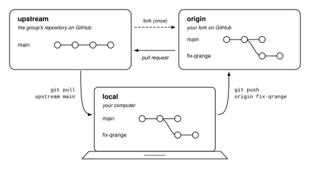

::: {.callout-tip appearance="simple"}
**New to git?** Start with [One folder to rule them all](git-workflow.qmd), which covers commits, branches, and GitHub from scratch. **Just need the commands?** Jump to the [cheat sheet](#cheat-sheet).
:::

## Three copies of one repository

When you contribute to a shared project, such as one of the group's analysis packages, there isn't one copy of the repository but three.

{fig-alt="Three boxes: the group's repository (upstream) and your fork (origin) on GitHub, and your computer (local), connected by arrows labelled fork, pull request, git pull upstream main, and git push origin fix-qrange" width="85%" fig-align="center"}

- **`upstream`** is the group's repository on GitHub. It holds the official version of the code. You don't push to it. Changes get there through pull requests, which a maintainer reviews and merges.
- **`origin`** is your **fork**: a copy of the group's repository under your own GitHub account. It has its own settings and permissions but stays connected to the repository it came from [@githubforks]. That connection lets you propose changes back. You can push whatever you like to your fork.
- **local** is the clone on your computer, where you edit, run, and commit.

`origin` and `upstream` are **remotes**: short names your local repository uses for the two GitHub addresses. Git calls the repository you cloned from `origin` automatically, and in a fork workflow you clone your fork. `upstream` is the name GitHub's documentation uses for the original repository [@githubforkremote]. To see yours:

```bash
git remote -v
```

```text
origin    git@github.com:<you>/<project>.git (fetch)
origin    git@github.com:<you>/<project>.git (push)
upstream  git@github.com:<group>/<project>.git (fetch)
upstream  git@github.com:<group>/<project>.git (push)
```

Commits travel in a loop:

1. **From `upstream` to your computer:** `git pull upstream main` brings the group's latest `main` down.
2. **From your computer to `origin`:** `git push origin <branch>` sends your work branch to your fork.
3. **From `origin` to `upstream`:** a **pull request** on GitHub asks the maintainers to merge that branch from your fork into the group's `main`.

Your own `main`, on your computer and on your fork, is only a **mirror of the group's `main`**. You never commit to it. All your work happens on branches. That one rule keeps everything else in this post simple.

## Why a fork and not branches in the group repository?

In a small private project with two or three people, it's perfectly fine for everyone to push branches to the same repository. That's the setup in the [git workflow post](git-workflow.qmd#working-with-co-authors). The group's shared packages work differently, for a few reasons:

- **Nobody needs write access** to the group repository to contribute. A new student or a visiting collaborator can fork, change, and open a pull request on their first day.
- **The group repository stays tidy.** It holds `main` and the releases, not dozens of half-finished personal branches called `test2` that nobody dares to delete.
- **Nobody breaks `main` by accident.** A mistyped `git push` lands in your fork, not in the code everyone else depends on.
- **Your fork is your sandbox.** You can push drafts and experiments, and even rewrite your own branches, without affecting anyone.
- **Every change gets reviewed.** The only way into `upstream` is a pull request, so someone else reads the diff and the automatic tests run before anything is merged.

The cost is an extra remote to keep in sync. Most of this post is about doing that well.

## The group's rules in short

The [Nanostructure group instruction file](nanostructure-group.qmd#group-file) sets out the branch discipline we follow, and that we ask AI agents to follow too. In plain words:

1. Go to `main`.
2. Update it from `upstream`.
3. Start a new branch from it, with a short name (`fix-qrange`, `feat-pdf-export`).
4. Commit your work on that branch. Start each message with a conventional prefix: `feat:`, `fix:`, `docs:`, `test:`, `refactor:`, or `chore:`.
5. Push the branch to your fork. The first time, use `git push -u origin <branch>`.
6. Open a pull request from your fork into `upstream`.

Never commit directly to `main`, and don't start a branch from another branch unless you mean to. Every pull request also needs a news file, made with `package add news` right after you create the branch.

::: {.callout-note}
## `checkout` or `switch`?
The group file writes steps 1 and 3 as `git checkout main` and `git checkout -b <branch>`. This post uses `git switch main` and `git switch -c <branch>`, which do exactly the same thing. [Scenario 3](#scenario-3-git-checkout-vs-git-switch) explains why there are two commands.
:::

## Avoiding merge conflicts

A merge conflict happens when two people change the same lines of the same file and git can't tell whose version to keep. The [git workflow post](git-workflow.qmd#side-quests-branches) shows what one looks like. You can't avoid them completely, but most come from habits you can change:

- **Never commit on `main`.** If your `main` only ever mirrors the group's, updating it is always a clean *fast-forward*: git moves it to the newest commit and there's nothing to merge.
- **Sync often.** Update `main` at the start of each working day, and always right before you start a branch. The further you drift from `upstream`, the bigger the merge when you come back.
- **Keep branches small and short-lived.** One topic per branch, and a pull request within days rather than months. A branch that lives for a semester will conflict with everything.
- **Say what you're working on.** Open an issue or a *draft* pull request early, so two people don't rewrite the same function in parallel. Most conflicts start as a communication problem.
- **Don't mix reformatting with real changes.** Reformatting a whole file touches every line, so it conflicts with everyone else's work on that file. The group's pre-commit hooks keep the formatting consistent from the start.
- **One news file per branch.** Each pull request adds its own `news/<branch>.rst` instead of editing a shared changelog, and separate files don't conflict.
- **Don't commit generated files.** Rendered output, figures made by a script, and notebook outputs change every time someone runs the code. Commit the code that makes them, and list the outputs in `.gitignore`.
- **One sentence per line** in LaTeX and Markdown. Git compares files line by line. If a whole paragraph sits on one line, two people fixing different sentences in it will conflict. With one sentence per line, they won't.
- **Bring `main` into your branch before you open a pull request,** and again if `upstream` moves on during the review ([Scenario 2](#scenario-2-syncing-with-the-remotes)). Any conflicts then show up on your own computer, where you can run the tests, rather than in the pull request.

## Scenario 1: clone, branch, commit, and push

### Once per project

1. **Fork** the group repository. Open it on GitHub and click **Fork** (top right). GitHub creates `github.com/<you>/<project>`.
2. **Clone your fork**, not the group repository:

   ```bash
   git clone git@github.com:<you>/<project>.git
   cd <project>
   ```

   Git automatically names your fork `origin`.

3. **Add the group repository as `upstream`:**

   ```bash
   git remote add upstream git@github.com:<group>/<project>.git
   git remote -v
   ```

   You should see the four lines [shown above](#three-copies-of-one-repository).

4. **Install the pre-commit hooks** with the project's conda environment active, so the style checks run on every commit:

   ```bash
   pre-commit install
   ```

Copy the addresses from the green **Code** button on each repository's GitHub page. The examples here use SSH addresses (`git@github.com:…`). HTTPS addresses (`https://github.com/…`) work the same way.

### Start a piece of work

```bash
git switch main
git pull upstream main
git switch -c fix-qrange
package add news -f "Default qmax in q_grid is now 25 1/Å"
```

`git switch -c` creates the branch and moves you onto it. Make the news file straight away, while you still remember what the branch is for.

### Edit, check, and commit

Make your changes, then look at what you did before committing:

```bash
git status
git diff
```

```text
On branch fix-qrange
Changes not staged for commit:
  (use "git add <file>..." to update what will be committed)
  (use "git restore <file>..." to discard changes in working directory)
        modified:   tools.py
```

```diff
-def q_grid(qmin, qmax):
+def q_grid(qmin, qmax=25.0):
     return qmin, qmax
```

When the diff shows only what you meant to change, commit it together with the news file:

```bash
git add tools.py news/fix-qrange.rst
git commit -m "fix: default qmax to 25 1/A"
```

Commit as often as it makes sense. Each commit is a step you might later want to explain or undo.

### Push to your fork

```bash
git push -u origin fix-qrange
```

```text
branch 'fix-qrange' set up to track 'origin/fix-qrange'.
To github.com:<you>/<project>.git
 * [new branch]      fix-qrange -> fix-qrange
```

`-u` (short for `--set-upstream`) links your local branch to `origin/fix-qrange`. From then on, a plain `git push` or `git pull` on this branch knows where to go. Git's word "upstream" here means "the remote branch this branch tracks". It has nothing to do with the remote we named `upstream`. Confusing, but harmless.

### Open the pull request

After the push, GitHub shows a **Compare & pull request** banner for the new branch. Check that the base is `main` of `<group>/<project>` and the head is `fix-qrange` of `<you>/<project>`. Describe what you changed and why, then create the pull request. If you aren't finished yet but would like early feedback, open it as a draft.

Keep pushing to the same branch while the review goes on. New commits show up in the pull request automatically.

### After the pull request is merged

```bash
git switch main
git pull upstream main                 # now includes your merged work
git push origin main                   # keep your fork's main in step
git branch -d fix-qrange               # delete the branch on your computer
git push origin --delete fix-qrange    # delete it on your fork
```

The **Delete branch** button on the merged pull request does the same as the last line.

If the maintainers used **Squash and merge**, `git branch -d` may refuse:

```text
error: The branch 'fix-qrange' is not fully merged.
If you are sure you want to delete it, run 'git branch -D fix-qrange'.
```

A squash merge combines all the commits in the pull request into a single new commit on `main` [@githubmerges]. Your original commits never appear in `main`'s history, so git thinks the branch isn't merged. (If the branch still exists on your fork, git deletes it anyway with a warning.) Check on GitHub that the pull request says **Merged**, then delete it with a capital `-D`.

## Scenario 2: syncing with the remotes

Your computer doesn't update itself. New commits can arrive from two places:

- **`upstream/main`** moves whenever the group merges someone's pull request.
- **`origin/<your-branch>`** moves when someone else adds commits to your branch on GitHub. That someone might be you, pushing from another computer, or a reviewer who clicks **Commit suggestion**, or GitHub's **Update branch** button on a pull request.

GitHub's **Sync fork** button on your fork's page brings your fork up to date with `upstream` [@githubsyncfork]. It only changes the copy on GitHub, though. Your computer still needs a `git pull`.

### Case A: you're on `main`

This is the simple case. You're on `main` with nothing uncommitted, say at the start of the day or just before starting a new branch:

```bash
git status
git pull upstream main
git push origin main
```

`git status` should say `nothing to commit, working tree clean`. The pull then looks like this:

```text
From github.com:<group>/<project>
 * branch            main       -> FETCH_HEAD
   0610c8b..295d4ab  main       -> upstream/main
Updating 0610c8b..295d4ab
Fast-forward
 README.md | 1 +
 1 file changed, 1 insertion(+)
```

The word to look for is **Fast-forward**. Git moved your `main` forward without merging anything, because it had no commits of its own. Afterwards, `git status` says `Your branch is ahead of 'origin/main'`, because your fork on GitHub is now behind. `git push origin main` brings it level again.

::: {.callout-tip}
## Make git refuse to merge on `main`
If you did commit on `main` by mistake, `git pull upstream main` can't fast-forward. What happens next depends on your git settings. Git either stops with `fatal: Need to specify how to reconcile divergent branches`, or quietly makes a merge commit on your `main`. A default Git for Windows install does the second.

To get the same safe behaviour on every computer, add `--ff-only`:

```bash
git pull --ff-only upstream main
```

If `main` has commits of its own, git then stops with `fatal: Not possible to fast-forward, aborting.` and leaves everything as it was. [When things go wrong](#when-things-go-wrong) shows how to move the stray commit to a branch.
:::

### Case B: you're in the middle of a branch

You've been working on `fix-qrange` for a few days. In the meantime, a colleague's pull request was merged into `upstream`, and you pushed a commit to the branch from your laptop. Before you continue, you want all of that in your branch.

The order is: **switch to `main`, pull, then merge `main` into your branch.**

```bash
# 1. Put unfinished work aside
git status
git stash                  # or commit it

# 2. Get your branch's new commits from your fork
git pull

# 3. Update main from the group repository
git switch main
git pull upstream main
git push origin main

# 4. Merge the new main into your branch
git switch fix-qrange
git merge main

# 5. Take your unfinished work back, test, and push
git stash pop
git push
```

1. Git won't switch branches if that would overwrite uncommitted changes. `git stash` puts them aside and leaves your working folder clean. If the work makes sense as a step of its own, commit it instead. Stashes are easy to forget.
2. You only need this if the branch is already on your fork. It brings in the commits that are on `origin/fix-qrange` but not on your computer. If you skip it, the push in step 5 will be rejected (see [When things go wrong](#when-things-go-wrong)).
3. This is exactly Case A.
4. Git adds the new commits from `main` to your branch with a merge commit. If you and your colleague changed the same lines, this is where the conflict appears ([below](#resolving-a-conflict)).
5. `git stash pop` brings back what you put aside in step 1. Run the tests before you push, because the code underneath your changes has moved.

Afterwards, `git log --oneline --graph` shows both lines of work joined together:

```text
*   5f44b2b Merge branch 'main' into fix-qrange
|\
| * 295d4ab docs: add README
* | deb1571 docs: add q_grid docstring
* | b2e7425 fix: default qmax to 25 1/A
|/
* 0610c8b feat: add q grid
```

**Why not pull `upstream` straight into the branch?** You can:

```bash
git fetch upstream
git merge upstream/main
```

`git fetch` downloads the new commits without changing any of your branches, and `git merge upstream/main` merges them in. Your branch ends up the same. The catch is that your local `main` stays behind, and you'll have to update it anyway before your next branch. Going through `main` keeps all three copies in step and is harder to get wrong.

### Resolving a conflict

If `git merge main` reports a conflict:

```text
Auto-merging tools.py
CONFLICT (content): Merge conflict in tools.py
Automatic merge failed; fix conflicts and then commit the result.
```

open the file. Git has marked both versions:

```text
<<<<<<< HEAD
def q_grid(qmin, qmax=25.0):
    """Return the Q range in 1/A."""
=======
def q_grid(qmin, qmax=30.0):
>>>>>>> main
    return qmin, qmax
```

Above `=======` is your branch (`HEAD`), and below it is what came in from `main`. Edit the block into what the code should be, delete the three marker lines, then:

```bash
git add tools.py
git commit
```

Without `-m`, `git commit` opens an editor with a ready-made merge message. Save and close it. If you'd rather deal with the conflict later, `git merge --abort` puts everything back the way it was before the merge.

VS Code shows **Accept Current Change**, **Accept Incoming Change**, and **Accept Both Changes** above each conflict, which is often easier than editing the markers by hand. Don't just click through them, though. In this example, two people chose different default values for `qmax`. That's a scientific decision, not a technical one. If you're not sure which version is right, ask the colleague who wrote the other one.

::: {.callout-note}
## What about `git rebase`?
You'll often see `git rebase main` recommended instead of `git merge main`. A rebase replays your commits on top of the new `main`, so the history is a straight line without merge commits. The price is that it rewrites your branch's commits. If you've already pushed the branch, you then have to overwrite it on your fork with `git push --force-with-lease`, and anyone else who has a copy of the branch is now out of step. Stick with merge unless the maintainers ask you to rebase. If the project squash-merges pull requests, the merge commits on your branch disappear anyway.
:::

## Scenario 3: `git checkout` vs `git switch`

For most of git's history, `git checkout` did two quite different jobs:

- **Move between branches:** `git checkout main`, `git checkout -b fix-qrange`.
- **Overwrite files** with the version from a commit: `git checkout -- tools.py`, `git checkout a1b2c3d -- tools.py`.

Git 2.23 (August 2019) split these jobs between two new commands [@gitrelnotes223]:

- **`git switch`** moves between branches [@gitswitch].
- **`git restore`** restores files [@gitrestore].

`git checkout` still works as before.

### Why the split matters

Switching branches is harmless. Both `git checkout <branch>` and `git switch <branch>` refuse to switch if that would overwrite uncommitted changes. Restoring files is not harmless. `git checkout -- tools.py`, or `git checkout .` for every file, replaces your edits with the committed version immediately, without asking, and git has no undo for work that was never committed. The two uses also look almost the same: `git checkout fix-qrange` moves you to a branch, while `git checkout tools.py` throws away your edits to that file.

`git switch` only ever changes branches, so it can't wipe your uncommitted edits by accident. It's explicit in other ways too. To look at an old commit, it wants `--detach`, so you can't end up in a detached HEAD without meaning to. When you really do want to throw edits away, `git restore` says so.

### Translation table

| `git checkout` | `git switch` / `git restore` | What it does |
|---|---|---|
| `git checkout main` | `git switch main` | Go to an existing branch |
| `git checkout -b fix-qrange` | `git switch -c fix-qrange` | Create a branch and go to it |
| `git checkout -` | `git switch -` | Go back to the previous branch |
| `git checkout a1b2c3d` | `git switch --detach a1b2c3d` | Look at an old commit ([detached HEAD](git-workflow.qmd#the-shadow-of-the-past)) |
| `git checkout -- tools.py` | `git restore tools.py` | Discard uncommitted edits to a file |
| `git checkout a1b2c3d -- tools.py` | `git restore --source=a1b2c3d --staged --worktree tools.py` | Get a file from an old commit |

There's one small difference in the last row. `git checkout <commit> -- <file>` puts the old version in your working folder **and** stages it for the next commit [@gitcheckout]. `git restore --source=<commit> <file>` changes only the working folder [@gitrestore]. That's usually what you want when you're looking at or running an old version. Add `--staged --worktree` to get exactly what `checkout` does.

### Which should I use?

- **Use `git switch` and `git restore`** in your own work. Their names say what they do, and `switch` can't eat your edits.
- **Read `git checkout` as a synonym.** You'll keep meeting it in older tutorials, Stack Overflow answers, the group instruction file, and commands that AI agents suggest. There, `git checkout main` means `git switch main`, and `git checkout -b x` means `git switch -c x`. You don't need to rewrite anything.
- **Check your git version** with `git --version`. Any version from 2.23 on has `switch` and `restore`.

### Switching to a branch that's only on a remote

Say you pushed `plot-sq` from your laptop and now want to work on it on your office computer. After `git fetch origin`, a plain `git switch plot-sq` creates a local `plot-sq` that tracks `origin/plot-sq`. Git does this automatically when exactly one remote has a branch of that name [@gitswitch]. With two remotes that isn't guaranteed. If `upstream` also has a `plot-sq`, git stops with `fatal: 'plot-sq' matched multiple (2) remote tracking branches`. Then name the remote yourself:

```bash
git switch -c plot-sq --track origin/plot-sq
```

## When things go wrong

**"I committed to `main` by mistake."** Move the commit onto a new branch, then reset `main` to the group's version. First make sure `git status` shows no uncommitted changes, because `reset --hard` discards them:

```bash
git switch -c fix-oops            # the new branch keeps your commit
git switch main
git fetch upstream
git reset --hard upstream/main    # main matches the group's main again
```

Your commit now lives on `fix-oops`, which you can push and turn into a pull request as usual. If you had already pushed the stray commit to your fork's `main`, finish with `git push --force-with-lease origin main`. This is one of the few times that overwriting a branch on your fork is the right thing to do.

**"`git push` was rejected."**

```text
 ! [rejected]        fix-qrange -> fix-qrange (fetch first)
error: failed to push some refs to 'github.com:<you>/<project>.git'
hint: Updates were rejected because the remote contains work that you do
hint: not have locally.
```

Your fork's copy of the branch has commits you don't have yet, perhaps from another computer or a reviewer's suggestion. Run `git pull`, resolve any conflicts, and push again. Don't reach for `git push --force`: it would delete those commits from your fork.

**"`git pull` says `Need to specify how to reconcile divergent branches`."** If you're on `main`, you committed there; see the first item. If you're on a work branch, both your computer and your fork have new commits on it. `git pull --no-rebase` merges them, which is what this post does throughout. To make merging the default, run `git config --global pull.rebase false` once. For `main`, keep using `--ff-only`, which overrides that setting.

**"My pull request contains commits that aren't mine."** You probably started the branch from another branch, or from a `main` that had stray commits of its own. The cleanest fix is to start a fresh branch from an up-to-date `main` and copy over only your own commits with `git cherry-pick <commit>`, one at a time, oldest first.

**"`git branch -d` won't delete a branch that was merged."** The pull request was squash-merged. See [After the pull request is merged](#after-the-pull-request-is-merged).

For anything else, [Oh Shit, Git!?!](https://ohshitgit.com) has a good collection of fixes.

## Cheat sheet {#cheat-sheet}

| When | What you want to do | Command |
|---|---|---|
| Once per project | Clone your fork | `git clone git@github.com:<you>/<project>.git` |
| | Add the group repository | `git remote add upstream git@github.com:<group>/<project>.git` |
| | Check the remotes | `git remote -v` |
| | Install the pre-commit hooks | `pre-commit install` |
| New work | Update `main` | `git switch main` then `git pull upstream main` |
| | Start a branch | `git switch -c <branch>` |
| | Add a news file | `package add news -f "Summary"` |
| While working | See what changed | `git status`, `git diff` |
| | Stage and commit | `git add <file>` then `git commit -m "fix: …"` |
| | First push of a branch | `git push -u origin <branch>` |
| | Later pushes | `git push` |
| Syncing | Update `main`, refusing if it has diverged | `git pull --ff-only upstream main` |
| | Update your fork's `main` | `git push origin main` |
| | Get new commits on your branch from your fork | `git pull` |
| | Merge the new `main` into your branch | `git switch <branch>` then `git merge main` |
| | Put unfinished work aside, and back | `git stash`, `git stash pop` |
| | Back out of a conflicted merge | `git merge --abort` |
| After the merge | Delete the branch on your computer | `git branch -d <branch>` (`-D` after a squash merge) |
| | Delete the branch on your fork | `git push origin --delete <branch>` |
| Moving around | Go to a branch | `git switch <branch>` (same as `git checkout <branch>`) |
| | Go back to the previous branch | `git switch -` |
| | Discard uncommitted edits to a file | `git restore <file>` (same as `git checkout -- <file>`) |

## Further reading

- [One folder to rule them all: a git workflow for research](git-workflow.qmd): git from scratch, branches, and how to review what an AI agent changed.
- [Best Practices for Nanostructure Group Members](nanostructure-group.qmd): the group instruction file these rules come from.
- [Onboarding](onboarding.qmd): installing git, Git Bash, and VS Code.
- *Pro Git*, [section 5.2, *Contributing to a Project*](https://git-scm.com/book/en/v2/Distributed-Git-Contributing-to-a-Project), walks through the fork workflow in more detail under *Forked Public Project* [@chacon2014progit].
- GitHub's documentation on [forks](https://docs.github.com/en/pull-requests/collaborating-with-pull-requests/working-with-forks/about-forks) [@githubforks], [configuring the `upstream` remote](https://docs.github.com/en/pull-requests/collaborating-with-pull-requests/working-with-forks/configuring-a-remote-repository-for-a-fork) [@githubforkremote], and [syncing a fork](https://docs.github.com/en/pull-requests/collaborating-with-pull-requests/working-with-forks/syncing-a-fork) [@githubsyncfork].
- The manual pages for [`git switch`](https://git-scm.com/docs/git-switch) [@gitswitch] and [`git restore`](https://git-scm.com/docs/git-restore) [@gitrestore].

## References {.unnumbered}

::: {#refs}
:::
