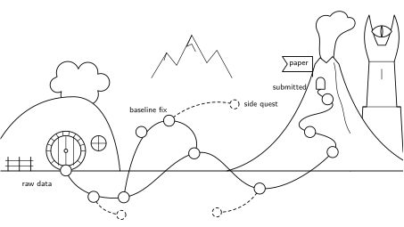

{fig-alt="A road of commits from the Shire to Mount Doom, with a detour that rejoins the road and side quests that end nowhere" width="75%" fig-align="center"}

::: {.callout-tip appearance="simple"}
**Already use git?** Jump to [Git and AI agents](#git-and-ai-agents) or the [cheat sheet](#cheat-sheet). Otherwise, start here. You can follow along with your own project folder.
:::

## Concerning folders

A couple of weeks before handing in his thesis, Sam needs to update Figure 3. His supervisor wants to see the cyclic voltammograms before the latest corrections, because "the peaks looked nicer in that version".

Fair enough. The problem is finding it.

```text
HEA_CVs/
├── plot_cv.py
├── plot_cv_new.py
├── plot_cv_new_FINAL.py
├── plot_cv_new_FINAL_v2_after_meeting.py
├── plot_cv_new_FINAL_v2_after_meeting_REALLY.py
├── fig3.png
├── fig3_new.png
├── fig3_new_new.png
└── HEA17_CV_C01.mpr
```

Which script produced `fig3_new.png`? Does `FINAL` include the iR correction? Was the electrode area changed before or after that meeting? Sam can work it out, probably, but it'll take an afternoon that could have been spent on the thesis.

Most of us have made some version of this folder. It's an understandable way to work: when a script finally produces a good figure, you make a copy before touching it again. Then another copy. Before long, the filenames are doing a very bad job of recording your decisions.

**Git lets you keep one working copy of the script while saving its history.** You can see what changed, recover an older version, and try something new without making another `FINAL_v2_REALLY.py`. It also makes working with co-authors and AI coding agents considerably less chaotic.

We'll follow Sam's BioLogic data from the first plotting script to the version submitted with the paper. The point isn't to turn everyone into a software developer. It's to make it easy to answer a very ordinary research question: *what exactly did I do to make this figure?*

Thanks to Till Schertenleib for suggesting the topic in the [Suggestion box](https://github.com/cheac-ai/cheac-ai.github.io/issues/13).

## A long-expected commit

Git records versions of files. Each saved version is called a **commit**: a snapshot of the files you chose, together with a short message about what you changed. You decide when to make one. Git doesn't save every keystroke.

That gives you two things a folder full of copies doesn't: a history you can inspect, and a way to move between versions without keeping them all on your desktop.

### Git is not GitHub

These two are often mentioned together, but they're different things:

- **Git** runs on your computer. It keeps the history, even without an internet connection or an account.
- **GitHub** hosts a copy of a git repository online. It's useful for sharing code, reviewing changes, and keeping another copy somewhere other than your laptop.

You can use git without GitHub. We'll start there and add GitHub once we have something worth sharing.

### Install git

- **Windows:** Install it from [git-scm.com](https://git-scm.com/downloads). The default settings are fine. The installer also includes *Git Bash*, where the commands below will work.
- **macOS:** Open Terminal and run `git --version`. If git isn't installed, macOS should offer to install the command-line tools.
- **Linux:** On Ubuntu, run `sudo apt install git`. Other distributions have equivalent packages.

Check that it works:

```bash
git --version
```

Then set the name and email that will appear next to your commits (once per computer):

```bash
git config --global user.name "Sam Gamgee"
git config --global user.email "sam@chem.ku.dk"
git config --global init.defaultBranch main
```

Use your own name and email, of course. The last line tells git to call the initial branch `main`.

::: {.callout-note}
## Don't like terminals?
[GitHub Desktop](https://desktop.github.com/) and [VS Code's Source Control panel](https://code.visualstudio.com/docs/sourcecontrol/overview) let you do most of this with buttons. They're perfectly good ways to use git. I'll show commands because they're easy to copy and work across operating systems.
:::

## The fellowship of the folder

Before using git, Sam cleans up the project. The [CHEAC Data Management Plan](../guidelines/cheac-dmp.qmd) already has a sensible approach: explain the project in a README, keep the original measurements untouched, and separate data, scripts, and figures.

Let's give the CV analysis a home:

```text
hea17-orr/
├── README.md              # what this project does and where the data is stored
├── .gitignore             # files git should leave alone
├── requirements.txt       # Python packages used for the analysis
├── data/
│   ├── raw/               # original BioLogic files, kept outside git
│   └── processed/         # smaller files produced during analysis
├── scripts/
│   └── plot_cv.py
└── figures/
    └── fig3_cv.png
```

It's still just an ordinary folder. Git doesn't require a particular structure, but it helps if the folder makes sense before you start recording its history.

### What should git keep?

Git works best with text files: Python scripts, notebooks, READMEs, configuration files, and reasonably small tables. Large binary files, especially ones that change often, can make a repository unnecessarily large.

For this project, we'll keep the code and small analysis files in git, but leave the original `.mpr` measurements in the lab's data storage on ASIMOV or ERDA. Sam creates a file called `.gitignore`:

```gitignore
# Original measurements are archived separately
data/raw/
*.mpr
.env

# Temporary Python and notebook files
__pycache__/
.ipynb_checkpoints/
```

The README should say **exactly where to find the raw files**, which measurements were used, and how to run the analysis. It's fine to have a local `data/raw/` folder containing copies of those files; git simply won't include them in commits.

This distinction matters. **Git keeps a history of your code, not a complete record of your experiment.** Reproducing a figure also requires the right raw measurements, calibration values, metadata, and software environment. That's why we keep `requirements.txt` alongside the script and archive the raw data separately.

GitHub has [ready-made `.gitignore` examples](https://github.com/github/gitignore) for common languages and tools. When your Python environment is working, you can record the installed versions with `python -m pip freeze > requirements.txt` (ideally from an environment made just for this project).

::: {.callout-warning}
## Keep credentials out of git
Passwords, access tokens, SSH keys, and anything else you wouldn't want to publish should stay out of the repository. Put local credentials in a separate ignored file or an environment variable. Deleting a secret from a script later does **not** remove it from git's history.
:::

### Your first commit

Open a terminal in the project folder:

```bash
cd hea17-orr
git init
git status
```

`git init` creates the repository. `git status` shows what's currently going on. Before the first commit, you'll see something like:

```text
On branch main
No commits yet

Untracked files:
  .gitignore
  README.md
  requirements.txt
  scripts/
```

Notice that `data/raw/` isn't listed. That's because we told git to ignore it. Empty folders won't show up either: git tracks files, not folders on their own.

Now save the first version:

```bash
git add .gitignore README.md requirements.txt scripts/
git commit -m "Add initial HEA17 CV plotting script"
```

`git add` chooses what goes into the next commit. `git commit` saves that version, and the text after `-m` is your note to your future self.

That's the basic idea. No GitHub account, no special project setup, and no more copying scripts to keep the old versions.

## The road goes ever on

Here's a shortened version of Sam's plotting script. It uses [ixdat](https://github.com/ixdat/ixdat) to load BioLogic measurements and plot the third CV cycle:

```python
# scripts/plot_cv.py
from pathlib import Path

import matplotlib.pyplot as plt
from ixdat import Measurement

raw = Path("data/raw")
files = sorted(raw.glob("HEA17_CV_*.mpr"))
if not files:
    raise FileNotFoundError("No HEA17 CV files found in data/raw/")

fig, ax = plt.subplots(figsize=(4, 3))
for path in files:
    cv = Measurement.read(path, reader="biologic").as_cv()
    cv.calibrate_RE(RE_vs_RHE=0.92)  # V, from the RHE calibration
    cv[3].plot_vs_potential(ax=ax, label=path.stem)

ax.legend(frameon=False, fontsize=7)
Path("figures").mkdir(exist_ok=True)
fig.savefig("figures/fig3_cv.png", dpi=300, bbox_inches="tight")
```

Run it from the project folder with `python scripts/plot_cv.py`. To install the packages used here:

```bash
python -m pip install ixdat matplotlib galvani
```

The `galvani` package is needed for ixdat to read many BioLogic `.mpr` files. If yours doesn't load, ixdat can also use `eclabfiles`, or you can export an `.mpt` text file from EC-Lab. The [ixdat documentation](https://ixdat.readthedocs.io/en/latest/) covers the different readers, including working with ASIMOV.

Keep `requirements.txt` updated when you change your Python packages. Together with the raw-data location, calibration values, and script, it gives someone else in the group a much better chance of reproducing the figure.

### The everyday workflow

A week later, Sam gets an impedance measurement and wants to add iR correction. The workflow is simple: **edit, check, commit**.

After adding the correction, run:

```bash
git diff
```

Git shows the difference between the working file and the last saved version:

```diff
     cv.calibrate_RE(RE_vs_RHE=0.92)  # V, from the RHE calibration
+    cv.correct_ohmic_drop(R_Ohm=45)  # ohm, from EIS
     cv[3].plot_vs_potential(ax=ax, label=path.stem)
```

A `+` means a line was added; a `-` means it was removed. Nothing mysterious happened here. Sam added the correction, checked that the change was what he intended, and saves it:

```bash
git add scripts/plot_cv.py
git commit -m "Add iR correction using 45 ohm from EIS"
```

That's most of what you need to do on a normal day. You don't have to commit every time you press Run. Commit when you've made a change you'd want to understand or recover later.

### Commit messages are for future you

A useful message says what changed and, when it isn't obvious, why. Compare these:

| Not very helpful | Much better |
|---|---|
| `update` | `Use cycle 3; earlier cycles still show oxide reduction` |
| `fix` | `Add iR correction using 45 ohm from EIS` |
| `new fig` | `Compare HEA17 and Pt reference in Fig. 3` |
| `asdf` | `Normalise current by geometric area (0.196 cm²)` |

Try to keep each commit about one thing. A change to the reference-electrode calibration and a change to the plot colours don't need to be in the same commit.

You can see the history at any point:

```bash
git log --oneline
```

```text
e41f0a2 Compare HEA17 and Pt reference in Fig. 3
9c3d7b1 Normalise current by geometric area (0.196 cm²)
5b2a8e4 Add iR correction using 45 ohm from EIS
a1b2c3d Add initial HEA17 CV plotting script
```

Each line is a commit. The short string on the left, such as `5b2a8e4`, identifies the version. That's what you'll use when someone asks about the figure from two weeks ago.

## The shadow of the past

And, sure enough, Sam's supervisor does. They want to compare the latest CV with the version before area normalisation.

The good news is that Sam doesn't have to guess which backup script was used. Git already knows. There are a few ways to go back, depending on what you want.

**Undo a change you haven't committed.** Say you've been editing `plot_cv.py`, it no longer runs, and you'd rather return to your last commit:

```bash
git restore scripts/plot_cv.py
```

This discards the uncommitted edits in that file. Check `git diff` first if you're unsure.

**Get one file from an older commit.** To run the version before area normalisation:

```bash
git restore --source=5b2a8e4 scripts/plot_cv.py
python scripts/plot_cv.py
```

Now Sam can regenerate the older figure with the same raw measurements. The old code is a temporary change in the working folder; the commit history hasn't moved. When he's finished comparing, he can restore the latest committed script:

```bash
git restore scripts/plot_cv.py
```

Be careful with the figure itself: the script may overwrite `figures/fig3_cv.png`. Save the comparison under a different name if you want both copies. And if you later reproduce a much older analysis, remember that the Python environment and raw-data versions may matter too.

**Visit an older version of the entire project.** First commit or set aside any work you want to keep. Then:

```bash
git switch --detach 5b2a8e4
# inspect files or run the old analysis
git switch main
```

Git calls this *detached HEAD*. The name sounds worse than it is. You're looking at a particular commit instead of working on a branch. `git switch main` gets you back.

**Reverse a commit without erasing the history.** If the area normalisation turns out to have used the wrong electrode area:

```bash
git revert 9c3d7b1
```

Git makes a new commit that undoes that change. You can still see both the mistake and the correction, much like in a proper lab notebook.

## Side quests: branches

Now Sam wants to try a different baseline correction. It might reveal a small oxidation peak. Or it might just make the plot worse.

This is where **branches** are handy. A branch is a separate line of commits. You can try something without changing the version you're currently happy with.

Start with a clean working folder, then:

```bash
git switch -c try-baseline
# edit and test the script
git add scripts/plot_cv.py
git commit -m "Try linear baseline between 0.05 and 0.25 V"
```

The main branch, `main`, is still where you left it.

**If the idea works**, bring it back:

```bash
git switch main
git merge try-baseline
git branch -d try-baseline
```

**If it doesn't**, leave it behind:

```bash
git switch main
git branch -D try-baseline
```

The capital `-D` forces deletion even though the experiment wasn't merged, so only use it when you're happy to discard the branch. You can also simply keep the branch around until you've decided.

Either way, there's no need for `plot_cv_baseline_TEST_dont_use.py`.

::: {.callout-note}
## What about merge conflicts?
If you changed the same lines on `main` and on your branch, git may need you to choose which edit to keep. It marks the disagreement in the file:

```text
<<<<<<< HEAD
    cv.correct_ohmic_drop(R_Ohm=45)
=======
    cv.correct_ohmic_drop(R_Ohm=47)  # re-measured
>>>>>>> try-baseline
```

Edit the file to keep the correct value, remove the marker lines, then run `git add scripts/plot_cv.py` and `git commit`. It's annoying the first time, but it's better than silently losing one person's correction.
:::

## Git and AI agents

Here's another situation that's probably becoming familiar. You ask an AI coding agent to fix a legend. It fixes the legend, but it also renames two variables, reorganises a function, and starts testing a different smoothing window. The new figure looks fine. The problem is that six files changed, and you didn't ask for most of it.

Git makes these changes much easier to deal with, because you can inspect what the agent actually did rather than relying on its description.

My rules are fairly simple:

1. **Commit your own work before starting.** If the agent makes a mess, you have a known-good version to return to. Check `git status` first; `git restore .` only discards unstaged changes to tracked files, not new untracked files or staged changes.
2. **Use a branch for larger experiments.** Let the agent try a new smoothing method on `try-smoothing`, not on the version you're preparing for the paper.
3. **Ask for small, focused changes.** Fix the legend, check the plot, commit. *Then* decide whether to do anything else.
4. **Read `git diff` yourself.** An agent's summary can miss things. The diff tells you which lines really changed.
5. **Don't let the agent decide what to investigate next.** If it suggests another analysis, ask what question that analysis would answer. A plausible-sounding side quest is still a side quest.

The same habits are useful when you're writing code yourself, but they're especially valuable with agents because they can change a lot of code very quickly.

If you use an instruction file (see [A CHEAC standard for AI agent instructions](agent-instructions.qmd)), you can put the rules there. For example, add this to `AGENTS.md` or `CLAUDE.md`:

```markdown
## Git
- Check `git status` before editing. If I have uncommitted work, don't
  overwrite it or make a commit without asking me.
- Use a separate branch for experiments; don't modify `main` without asking.
- Keep changes focused. Make small commits with messages saying what changed.
- Never commit raw measurements, credentials, tokens, or other ignored files.
- Show me the diff before treating a task as finished.
- Ask before merging, rebasing, pushing, force-pushing, or deleting branches.
- Don't suggest additional analyses unless you can explain what question
  they would answer.
```

One important detail: don't give an agent blanket permission to run destructive git commands. In particular, `git restore`, `git reset --hard`, and `git clean` can wipe out work that hasn't been committed. Make sure you know what's about to be discarded.

## The fellowship: GitHub and co-authors

Until now, the repository has lived entirely on Sam's laptop. That works, but it's risky. If the laptop disappears, the local git history goes with it.

Time to put a copy online. GitHub is convenient, although it doesn't replace the group's proper data storage and backup arrangements.

1. Create an account at [github.com](https://github.com).
2. Install the [GitHub CLI](https://cli.github.com) and log in:

   ```bash
   gh auth login
   ```

3. In the project folder, create a **private** repository and push the existing history:

   ```bash
   gh repo create hea17-orr --private --source=. --remote=origin --push
   ```

After that, the usual commands are:

```bash
git push    # send your commits to GitHub
git pull    # bring in commits from GitHub
```

Start private, especially if the project contains unpublished work. Before making it public, check what you've committed, whether you have permission to share it, and whether the repository contains data or information that should stay internal.

### Working with co-authors

Merry is working on the DFT part of the paper and wants to change the plotting script. Rather than emailing an edited file to Sam, Merry makes a branch and opens a **pull request** on GitHub.

A pull request is just a proposed change. Sam can look through the diff, comment on individual lines, ask Merry to adjust things, and merge it into `main` when they're both happy. It's a particularly nice way to review changes to analysis scripts without having to compare two attachments called `final.py`.

This website is updated through pull requests too.

## There and back again

The paper is ready. The figures have been checked, the scripts are committed, and the raw data is stored where the group expects it. A few final steps make it easier to return to the submitted version later.

### Mark the version you submitted

A **tag** gives a particular commit a name. Sam tags the version used for submission:

```bash
git tag -a v1.0-submitted -m "Version submitted to ACS Catalysis"
git push origin v1.0-submitted
```

When Reviewer 2 asks for another control experiment, Sam can do the revision work as usual and later tag `v1.1-revision`. The original submission stays easy to find.

### Archive the code alongside the data

Git can package the tagged files into a zip:

```bash
git archive --format=zip -o hea17-orr-v1.0.zip v1.0-submitted
```

This contains the **tracked files in that commit**, not the git history and not the ignored raw measurements. Put it in the ERDA project archive alongside the raw data, relevant metadata, and anything else needed to rerun the analysis. Follow the [CHEAC Data Management Plan](../guidelines/cheac-dmp.qmd) for the full archiving requirements.

If you need the full git history in the archive as well, archive the repository separately; `git archive` intentionally makes a clean source snapshot.

### Give the code a DOI (optional)

If the code is going to be public, you can connect the GitHub repository to [Zenodo](https://zenodo.org), create a GitHub release from the tag, and have Zenodo archive that release with a DOI. [GitHub has a guide](https://docs.github.com/en/repositories/archiving-a-github-repository/referencing-and-citing-content). It's an easy way to give readers a specific, citable version rather than a link to a repository that may keep changing.

And that's it. Sam still has one plotting script in his working folder. The difference is that all the earlier versions are in git, complete with the changes that got him from one to the next.

He can finally delete `plot_cv_new_FINAL_v2_after_meeting_REALLY.py`.

## When things go wrong

**"I accidentally staged something."** Unstage it without deleting the file:

```bash
git restore --staged data/processed/results.csv
```

**"I committed a huge raw-data file."** First, stop tracking it and add it to `.gitignore`:

```bash
git rm --cached data/raw/huge_file.mpr
```

If you added the file **in your most recent commit and haven't pushed**, you can amend that commit after updating `.gitignore`:

```bash
git add .gitignore
git commit --amend --no-edit
```

If the file was committed earlier, or has already been pushed, that doesn't remove it from the old history. Cleaning the history takes extra steps and may affect collaborators. Get help before rewriting a shared repository's history.

**"I committed a password or token."** Revoke or rotate it immediately. Even if you remove it from your latest file, the old value may still be accessible in the history.

**"Git says detached HEAD."** You're looking at an old commit. If you've only been inspecting things, `git switch main` takes you back. If you've made commits there that you want to keep, make a branch before switching.

**"I broke the script and want the last committed version back."** Check what you're throwing away with `git diff`, then:

```bash
git restore scripts/plot_cv.py
```

For everything else, [Oh Shit, Git!?!](https://ohshitgit.com) is a very good collection of solutions to common git disasters.

## Cheat sheet

| What you want to do | Command |
|---|---|
| Start a repository | `git init` |
| Check what's changed | `git status` |
| See edits line by line | `git diff` |
| Stage a file | `git add <file>` |
| Unstage a file | `git restore --staged <file>` |
| Save a version | `git commit -m "What changed"` |
| See past versions | `git log --oneline` |
| Discard uncommitted edits to a tracked file | `git restore <file>` |
| Get a file from an old commit | `git restore --source=<commit> <file>` |
| Visit an old commit | `git switch --detach <commit>` |
| Return to `main` | `git switch main` |
| Reverse a commit with a new one | `git revert <commit>` |
| Start an experimental branch | `git switch -c try-<name>` |
| Merge the experiment | `git switch main` then `git merge try-<name>` |
| Delete a merged branch | `git branch -d try-<name>` |
| Force-delete an unmerged branch | `git branch -D try-<name>` |
| Send commits to GitHub | `git push` |
| Get changes from GitHub | `git pull` |
| Tag a version | `git tag -a v1.0-submitted -m "..."` |
| Export tagged files as a zip | `git archive --format=zip -o out.zip v1.0-submitted` |

There's also a printable [GitHub cheat sheet](https://education.github.com/git-cheat-sheet-education.pdf).

## Further reading

- [Software Carpentry: Version Control with Git](https://swcarpentry.github.io/git-novice/) is written for researchers and includes exercises you can follow.
- *Pro Git* is a free book if you want to understand what happens underneath [@chacon2014progit].
- Short introductions to git in research: [@blischak2016quick] and [@ram2013git].
- *Good enough practices in scientific computing* is a useful guide to keeping research projects manageable [@wilson2017good].

## References {.unnumbered}

::: {#refs}
:::
