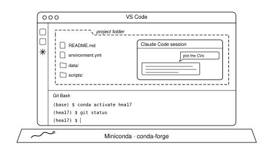

{fig-alt="A VS Code window standing on a Miniconda base, with a Git Bash terminal and a Claude Code session inside one dashed project folder" width="75%" fig-align="center"}

::: {.callout-tip appearance="simple"}
**Already have conda, git, and VS Code?** Skip to [Claude Code in VS Code](#claude-code-in-vs-code), and in particular [How sessions work](#how-sessions-work) and [Keeping a session inside a project](#keeping-a-session-inside-a-project).
:::

## What you'll have at the end

This page takes a new laptop to a setup where you can write and run Python for your research, keep it under version control, and work with an AI agent in the same window. In order:

1. **Miniconda**, to install Python and keep a separate environment for each project.
2. **git**, and on Windows **Git Bash**, so that everyone at CHEAC types the same commands.
3. **conda inside that shell**, so `conda activate` works wherever you type it.
4. **VS Code**, opened on a project folder, with your conda environment and Git Bash in its terminal.
5. **Claude Code** in VS Code, and how its sessions relate to the folder you have open.

Every step has a Windows and a macOS version where they differ. Once you're set up, two other posts take over: [One folder to rule them all](git-workflow.qmd) for working with git, and [A CHEAC standard for AI agent instructions](agent-instructions.qmd) for telling the agent how to behave.

## Install Miniconda

[Miniconda](https://www.anaconda.com/docs/getting-started/miniconda/main) is a small installer for **conda**, a tool that installs Python and scientific packages into separate *environments*. One environment per project means that upgrading NumPy for your new project doesn't break the script you wrote for last year's paper.

::: {.panel-tabset}

## Windows

1. Download the Windows installer from the [Miniconda page](https://www.anaconda.com/download/success#miniconda).
2. Run it and choose **Just Me**. Keep the default folder, `C:\Users\<you>\miniconda3`.
3. Leave **Add Miniconda3 to my PATH** unticked (the default). We'll make conda available in Git Bash in a moment instead.

## macOS

Open Terminal and check which processor you have:

```bash
uname -m
```

`arm64` means Apple Silicon (M1 and later); `x86_64` means Intel. Then download and run the matching installer into `~/miniconda3`:

```bash
# Apple Silicon. On an Intel Mac, replace arm64 with x86_64.
curl -O https://repo.anaconda.com/miniconda/Miniconda3-latest-MacOSX-arm64.sh
bash Miniconda3-latest-MacOSX-arm64.sh -b -p ~/miniconda3
rm Miniconda3-latest-MacOSX-arm64.sh
```

:::

### Switch to conda-forge

Out of the box, conda downloads packages from Anaconda's own `defaults` channel. Anaconda's terms of service require a paid licence to use that channel in organisations with 200 or more employees [@anacondatos], and the University of Copenhagen is well past that. **conda-forge** is a community channel with the same scientific packages, free for everyone [@condaforge]. Most of the scientific Python world already uses it.

Once conda works in your terminal (next two sections), run these three commands once:

```bash
conda config --add channels conda-forge
conda config --set channel_priority strict
conda config --remove channels defaults
```

Then check:

```bash
conda config --show channels
```

```text
channels:
  - conda-forge
```

::: {.callout-note}
## Prefer not to think about channels?
[Miniforge](https://conda-forge.org/download/) is Miniconda with conda-forge already set as the only channel. If you install Miniforge instead, skip this step. Everything else on this page is the same, apart from the folder name (`miniforge3` instead of `miniconda3`).
:::

## Install git and Git Bash

Git keeps the history of your scripts. The [git workflow post](git-workflow.qmd) explains why that's useful. Here we only install it.

::: {.panel-tabset}

## Windows

Download git from [git-scm.com](https://git-scm.com/downloads/win) and run the installer. The default settings are fine.

The installer also gives you **Git Bash**, a terminal that understands the same commands as macOS and Linux (`ls`, `cd`, `cp`, and so on). That's why we use it: the commands in the CHEAC posts, and most of what you'll find online, work in Git Bash unchanged. Claude Code also uses Git Bash for its shell commands when it's installed [@claudecodesetup].

## macOS

Open Terminal and run:

```bash
git --version
```

If git isn't installed, macOS offers to install the *Command Line Tools*. Accept, and run the command again. You don't need Git Bash on a Mac: Terminal already speaks the same language.

:::

Then set your name and email once, as described in [Install git](git-workflow.qmd#install-git).

## Make conda work in your terminal

Conda needs a few lines in your shell's start-up file before `conda activate` works. `conda init` writes them for you.

::: {.panel-tabset}

## Windows (Git Bash)

Open **Git Bash** from the Start menu and run:

```bash
~/miniconda3/Scripts/conda.exe init bash
```

Close Git Bash, open it again, and check:

```bash
conda --version
conda activate base
```

The prompt should now start with `(base)`. `conda init` added its lines to `~/.bash_profile`, which Git Bash reads every time it starts.

If `conda` is still not found, add the line yourself and reopen Git Bash:

```bash
echo '. ~/miniconda3/etc/profile.d/conda.sh' >> ~/.bash_profile
```

## macOS

The default shell on a Mac is zsh. Run:

```bash
~/miniconda3/bin/conda init zsh
```

Close Terminal, open it again, and check:

```bash
conda --version
```

The prompt should now start with `(base)`.

:::

Now go back and [switch to conda-forge](#switch-to-conda-forge) if you haven't yet.

If you'd rather not have `(base)` activated in every new terminal, turn it off:

```bash
conda config --set auto_activate_base false
```

### One environment per project

Don't install your packages into `base`. Make an environment for each project, named after it:

```bash
conda create -n hea17 python=3.12 numpy scipy matplotlib
conda activate hea17
```

Install more packages into it as you need them (`conda install pandas`, or `python -m pip install ixdat` for packages that aren't on conda-forge). When the analysis works, save a list of what you asked for in the project folder:

```bash
conda env export --from-history > environment.yml
```

Someone else (or you, on a new laptop) can then rebuild the environment with `conda env create -f environment.yml`. Commit `environment.yml` together with your scripts. It does the same job as the `requirements.txt` in the [git workflow post](git-workflow.qmd#what-should-git-keep).

::: {.callout-note}
## Interactive Python in the Git Bash window
If typing `python` in the standalone Git Bash window just hangs, start it with `winpty python` instead. Scripts (`python plot_cv.py`) run normally, and the VS Code terminal below doesn't have this problem.
:::

## Install VS Code

[VS Code](https://code.visualstudio.com) is a free code editor. You get your files, a terminal, git, and Claude Code in one window.

1. Download and install it from [code.visualstudio.com](https://code.visualstudio.com). On macOS, drag it into *Applications*, open it, press `Cmd+Shift+P`, and run **Shell Command: Install 'code' command in PATH**. That lets you open a folder from Terminal with `code .`.
2. Open the **Extensions** view (the four-squares icon on the left) and install **Python** (by Microsoft). Add **Jupyter** if you use notebooks.

### Open a folder, not a file

Always work in VS Code through **File → Open Folder…** and pick the project folder (`hea17-orr/`, say). When VS Code asks whether you trust the authors of the files in this folder, answer yes for your own projects.

This matters more than it looks. The folder you open is what VS Code shows in its file explorer and opens its terminal in. It's also the folder Claude Code treats as its workspace (more on that [below](#keeping-a-session-inside-a-project)). Use one window per project.

### Use Git Bash as the terminal (Windows)

VS Code's terminal (`` Ctrl+` ``) starts PowerShell by default on Windows. To make it Git Bash:

1. Press `Ctrl+Shift+P` and run **Terminal: Select Default Profile**.
2. Choose **Git Bash**.
3. Close any open terminal (bin icon) and open a new one.

The same setting in your user `settings.json` (`Ctrl+Shift+P` → **Preferences: Open User Settings (JSON)**):

```json
"terminal.integrated.defaultProfile.windows": "Git Bash"
```

On macOS the terminal already uses zsh, and there's nothing to change.

### Activate your environment

Tell VS Code which conda environment belongs to this project:

1. Press `Ctrl+Shift+P` (`Cmd+Shift+P` on a Mac) and run **Python: Select Interpreter**.
2. Pick the environment, e.g. `hea17` (it shows the path `~/miniconda3/envs/hea17`).

VS Code uses that interpreter when you press Run on a Python file, and activates the environment in **new** terminals. Open a fresh terminal and check:

```bash
conda info --envs     # the active environment is marked with *
which python          # should point into miniconda3/envs/hea17
```

If the prompt doesn't show `(hea17)`, run `conda activate hea17` yourself. That always works, because conda is set up in the shell.

## Claude Code in VS Code

[Claude Code](https://code.claude.com/docs/en/overview) is Anthropic's AI agent. It can read the files in your project, edit them, and run commands, with your approval. The [agent instructions post](agent-instructions.qmd) explains what agents are and how to give them standing instructions. Here we set it up in VS Code and look at how its sessions work.

### Install and sign in

1. In the Extensions view, search for **Claude Code** and install the extension published by **Anthropic**.
2. Click the **Spark icon** (✻) at the top right of an open file, or **✻ Claude Code** in the status bar at the bottom right.
3. Click **Sign in** and finish in the browser. You need a paid Claude plan (Pro, Max, Team, or Enterprise) or an Anthropic Console account. The free plan doesn't include Claude Code [@claudecodevscode].

The extension includes everything it needs. You don't have to install the command-line version separately. On Windows, it uses Git Bash for shell commands if git is installed, and PowerShell otherwise [@claudecodesetup].

The extension also activates the project's Python environment when it runs commands (the setting `claudeCode.usePythonEnvironment`, on by default). So once you've picked `hea17` with **Python: Select Interpreter**, a `python plot_cv.py` that Claude runs uses the same packages as yours.

### Your first prompts

- **Ask about a file.** Type `@` and part of a file name to point Claude at it: "What does `@scripts/plot_cv.py` do with the reference electrode?" Selected text in the editor is passed along automatically.
- **Check the permission mode** under the prompt box. Start in **Manual**: Claude shows every edit as a side-by-side diff and asks before applying it or running a command. **Plan** mode lets it read and propose a plan without editing anything, which is a good start for a larger task. **Edit automatically** and **Auto** skip most questions. Leave those until you know how Claude works in your project.
- **Undo.** Hover over one of your earlier messages and choose **Rewind code to here** to roll back the files Claude changed after that point. Git is still the better safety net. See [Git and AI agents](git-workflow.qmd#git-and-ai-agents).
- **Give it standing instructions** in a `CLAUDE.md` file, as described in [the CHEAC standard](agent-instructions.qmd#cheac-standard).

### How sessions work

A **session** is one conversation with Claude: your messages, its replies, and every file it read or command it ran along the way. Everything in it counts toward the model's context, the text it has in view when it answers.

**A session belongs to the folder it started in.** Claude Code saves each session on your computer as it goes, in a folder named after the project folder [@claudecodesessions]:

```text
~/.claude/projects/
├── C--Users-sam-projects-hea17-orr/      # one folder per project folder
│   ├── 3f2a…e81.jsonl                    # one file per session
│   └── 9b07…c4d.jsonl
└── C--Users-sam-projects-xrd-fits/
    └── …
```

Some practical consequences:

- **History follows the folder.** Click **Session history** at the top of the Claude panel, or the Spark icon in the left Activity Bar, to see past sessions for the folder you have open, and click one to continue it. Open a different project folder and you see that project's sessions instead.
- **Each tab is a separate session.** **Claude Code: Open in New Tab** from the Command Palette starts a second, independent conversation in the same folder. That's handy for a side question, but two sessions editing the same files at once will get in each other's way. Give them separate files or separate [git branches](git-workflow.qmd#side-quests-branches).
- **A new session starts blank.** It knows nothing from earlier sessions except what's in your instruction files (`CLAUDE.md` / `AGENTS.md`) and anything Claude has saved to its memory for this project. If a fact matters for every session, put it in the instruction file rather than repeating it.
- **Keep sessions short and focused.** One task per session works best. Type `/clear` to start fresh when you change topic (the old session stays in the history), or `/compact` to have Claude summarise a long conversation and continue from the summary. Rename sessions you'll come back to.
- **Sessions are local and temporary.** They aren't synced anywhere. The VS Code list archives a session after 14 days without activity, and Claude Code deletes saved sessions after 30 days by default (`cleanupPeriodDays` in the settings). A session is not a lab notebook. Results, decisions, and code belong in the project folder and in git.

### Is a session confined to its folder?

Partly. The folder you have open is the session's **working directory**, and Claude's file tools treat it as a boundary [@claudecodepermissions]:

| What Claude does | Inside the project folder | Outside it |
|---|---|---|
| Read a file | No question asked | Asks you first |
| Edit or create a file | Asks you (in Manual mode) | Asks you |
| Run a shell command | Asks you, except for read-only commands like `ls` or `git status` | Asks you |

The last row is the catch. **A shell command runs with your own user rights.** `python some_script.py` or `cp -r` can reach any file you can reach, wherever it is. The folder boundary is enforced for Claude's file tools, not for the programs it starts. So the most important protection is still you, reading the command before you approve it.

### Keeping a session inside a project

You can tighten things up in a few ways, from simplest to strictest:

**1. Open one project folder per window.** That folder is the working directory, so Claude reads freely there and asks about everything else. Don't open your whole home folder or `Documents` as a workspace: then *everything* is "inside".

**2. Add other folders on purpose.** If the analysis needs a folder elsewhere, such as raw data on a mapped ERDA drive, type `/add-dir <path>` in the session, or list it under `additionalDirectories` in the settings. Claude can then read there without asking, under the same rules as the project folder.

**3. Block reads outside the project and protect raw data.** Put a settings file in the project, `.claude/settings.json`:

```json
{
  "permissions": {
    "blockReadsOutsideWorkingDirectories": true,
    "deny": [
      "Edit(/data/raw/**)",
      "Read(/.env)"
    ]
  }
}
```

- `blockReadsOutsideWorkingDirectories` makes Claude's file tools refuse files outside the project folder (and any added folders), in every permission mode, instead of asking.
- `deny` rules forbid specific actions. A path starting with `/` is relative to the project folder, so `Edit(/data/raw/**)` stops Claude from editing anything in `data/raw/`. That matches the "raw data is read-only" rule in the [CHEAC Data Management Plan](../guidelines/cheac-dmp.qmd).

To apply the same rules to all your projects, put them in `~/.claude/settings.json` instead. You can also add and remove rules through the extension: type `/` in the prompt box to open the command menu and choose **Permissions** under *Customize*.

Deny rules also cover the common file commands Claude runs in the shell, such as `cat`, `sed`, and redirects like `> file`. They don't cover a Python script that opens the file itself. Treat them as a strong guard rail, not a wall.

**4. Sandbox shell commands (macOS).** On macOS, type `/sandbox` to run Claude's shell commands in an operating-system sandbox that limits them to the project folder and to network hosts you allow. This *does* hold for scripts Claude starts. Sandboxing isn't available on native Windows (it is in WSL 2) [@claudecodesetup].

**5. Don't move sessions casually.** `/cd <path>` moves a running session to a different folder, and from then on it treats that folder as its workspace. It's useful when you really mean it, but it's an easy way to lose track of what the session can touch.

Whatever you set up, the [git habits](git-workflow.qmd#git-and-ai-agents) still apply: commit before you start a session, and read `git diff` before you accept that it's finished.

## Checklist

Open a new terminal in VS Code (Git Bash on Windows) and check each step:

| Step | Command | You should see |
|---|---|---|
| conda | `conda --version` | `conda 25.x` or similar |
| conda-forge | `conda config --show channels` | only `conda-forge` |
| Project environment | `conda activate hea17` then `which python` | a path inside `miniconda3/envs/hea17` |
| git | `git --version` | `git version 2.x` |
| git identity | `git config --global user.name` | your name |
| VS Code | `code --version` | a version number |
| Claude Code | type `/status` in the Claude panel | your account, model, and version |

When all seven work, you're set up. Next: [put a project under git](git-workflow.qmd) and [write your instruction file](agent-instructions.qmd).

## Further reading

- [Conda: managing environments](https://docs.conda.io/projects/conda/en/latest/user-guide/tasks/manage-environments.html), the official guide to creating, exporting, and removing environments.
- [Python environments in VS Code](https://code.visualstudio.com/docs/python/environments).
- [Use Claude Code in VS Code](https://code.claude.com/docs/en/vs-code) [@claudecodevscode].
- [Manage sessions](https://code.claude.com/docs/en/sessions) and [Configure permissions](https://code.claude.com/docs/en/permissions) in the Claude Code documentation [@claudecodesessions; @claudecodepermissions].

## References {.unnumbered}

::: {#refs}
:::
