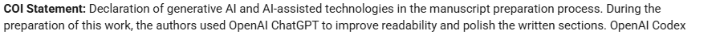
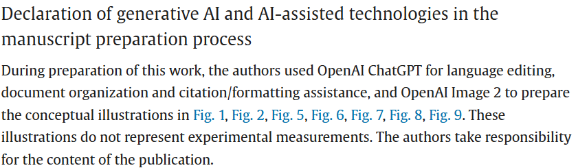
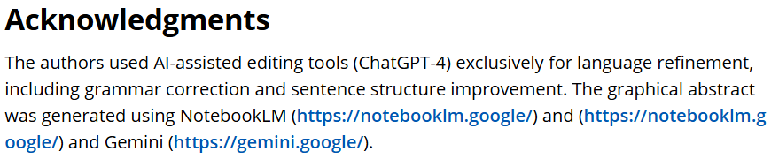
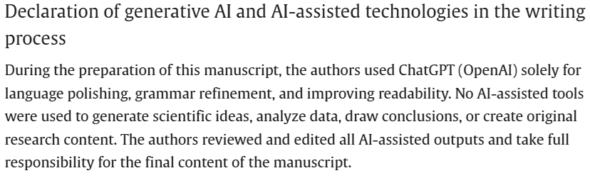
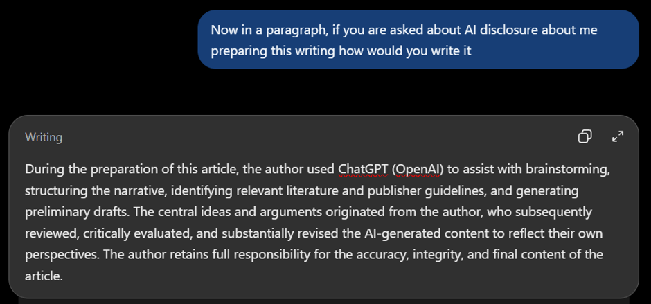

In 2023, Harvard Business School professor Karim Lakhani discussed the impact of AI in a *Harvard Business Review* article titled *AI Won't Replace Humans—But Humans with AI Will Replace Humans Without AI* [@hbr2023ai].

Whether or not we entirely agree with that statement, it captures the growing importance of artificial intelligence in our professional lives. Over the past few years, generative AI has developed remarkably quickly, transforming from a technological novelty into a tool increasingly integrated into everyday activities, including scientific research.

This development is also reflected in scientific publications. In a recent study, @he2026aipolicies analyzed more than five million scientific papers to estimate the proportion of AI-generated content in scientific writing. Using statistical patterns in published texts, they observed a substantial increase in the estimated presence of AI-generated writing after 2023, across various scientific disciplines, including the physical and life sciences. Although these estimates do not directly measure how many researchers use AI, they provide an indication of the growing influence of AI-assisted writing in scientific communication.

![Trends of AI usage in recent years [@he2026aipolicies].](figure1.jpg){#fig-ai-trends fig-alt="Trends in estimated AI-assisted scientific writing across research disciplines" width="100%" fig-align="center"}

Personally, I began to appreciate the usefulness of generative AI after the release of GPT-4 in 2023. What initially seemed like a sophisticated chatbot gradually became a useful companion for learning, brainstorming, programming, and scientific writing. Today, AI-assisted tools are increasingly accessible to researchers, from students preparing their first scientific manuscripts to experienced scientists working on complex research problems.

With these developments comes a seemingly simple question: **How should we acknowledge the use of AI in our research?**

## How do researchers acknowledge AI?

You have probably encountered a statement similar to this in a scientific publication: the authors used ChatGPT to improve the language, grammar, and readability of their manuscript.

{#fig-paper1 fig-alt="Screenshot of an AI-use declaration from example paper 1" width="100%" fig-align="center"}

{#fig-paper2 fig-alt="Screenshot of an AI-use declaration from example paper 2" width="100%" fig-align="center"}

{#fig-paper3 fig-alt="Screenshot of an AI-use declaration from example paper 3" width="100%" fig-align="center"}

{#fig-paper4 fig-alt="Screenshot of an AI-use declaration from example paper 4" width="100%" fig-align="center"}

These examples illustrate that AI acknowledgments are not limited to language refinement. Researchers may also report assistance with programming, literature research, document organization, and scientific illustrations.

**But how representative are these different types of acknowledgment?**

@kousha2024acknowledged investigated this question by analyzing 1,759 scientific publications that explicitly acknowledged ChatGPT, indexed in Scopus and Web of Science up to August 2024. The study found that approximately 80% of the acknowledgments concerned text editing and proofreading. In contrast, only 5.3% reported non-editorial research support, such as programming or data analysis, while 3.5% acknowledged assistance with manuscript drafting.

![Classification of ChatGPT acknowledgments in academic publications [@kousha2025acknowledge].](figure2.png){#fig-acknowledgment-categories fig-alt="Chart classifying the acknowledged uses of ChatGPT in 1,759 academic publications" width="100%" fig-align="center"}

These findings suggest that language-related assistance dominated the reported uses of ChatGPT in this dataset. However, it is important to distinguish what researchers explicitly acknowledge from what they actually use AI for. The study uses data collected up to August 2024, so it may not reflect current practice.

## What do the publishers actually require?

As AI becomes increasingly integrated into scientific research, several major publishers have introduced guidelines explaining how researchers should disclose the use of AI when preparing and submitting manuscripts. The following summary reflects the guidance as of November 2026.

### Nature Portfolio and Springer Nature

Official guidelines: [Nature Portfolio — Artificial Intelligence](https://www.nature.com/nature-portfolio/editorial-policies/ai)

Additional guidance: [Springer Nature — AI Use in Manuscript Preparation](https://www.springernature.com/gp/policies/editorial-policies/ai-manuscript-preparation)

Nature Portfolio adopts a risk-based framework distinguishing low-risk assistive AI use, uses requiring greater caution and disclosure, and uses that are not permitted. The framework emphasizes transparency, human verification, and authors' responsibility for their published work.

### Wiley

Official guidelines: [Wiley — Using AI Tools in Your Research](https://www.wiley.com/en-ae/publishing/article/ai-guidelines)

Wiley provides specific guidance on where and how authors should declare AI use. Notably, simple grammar correction, spelling checks, and language polishing typically do not require disclosure, whereas substantial content generation, research assistance, and other consequential uses must be appropriately documented.

### Elsevier

Official guidelines: [Elsevier — Generative AI Policies for Journals](https://www.elsevier.com/about/policies-and-standards/generative-ai-policies-for-journals)

Elsevier provides a recommended format for declaring generative AI assistance during manuscript preparation. Authors are instructed to identify the tools used, explain their purposes, and confirm their responsibility for the final content. AI tools used as part of research methodology should instead be described in the Methods section.

These publisher guidelines illustrate how scientific publishing is adapting to the increasing presence of AI in research and manuscript preparation. Although the specific requirements differ, they establish expectations about transparency and accountability. Authors should also consult the instructions of the individual journal to which they are submitting, as requirements may vary.

## Where does that leave us?

We have seen how researchers disclose AI assistance and how publishers are establishing expectations for responsible reporting. At the same time, AI is becoming capable of assisting with more complex tasks. As its role in research develops, the way we communicate that role may also need to evolve.

This leaves us with a question worth considering: **When we declare that AI was used in our research, how much does that statement actually tell the reader? And how should we report it?**

More on this in a future  \btw article.

## AI disclosure

{#fig-ai-disclosure fig-alt="Screenshot of a ChatGPT-generated declaration describing assistance with brainstorming, structure, literature searches, and drafting, with author review and responsibility" width="100%" fig-align="center"}

## References {.unnumbered}

::: {#refs}
:::
